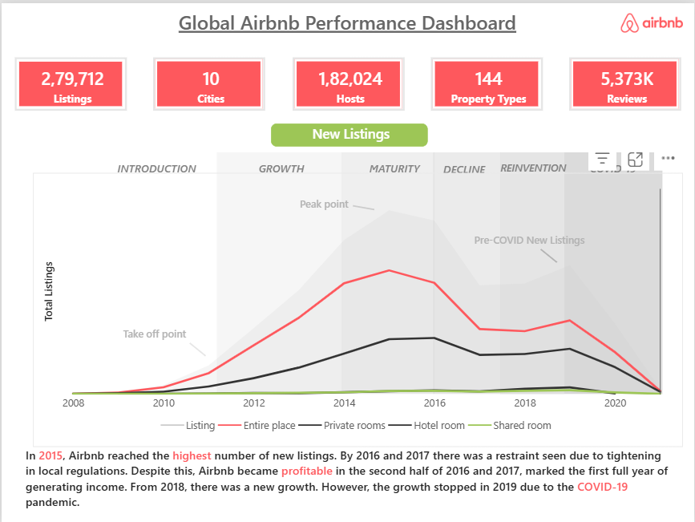
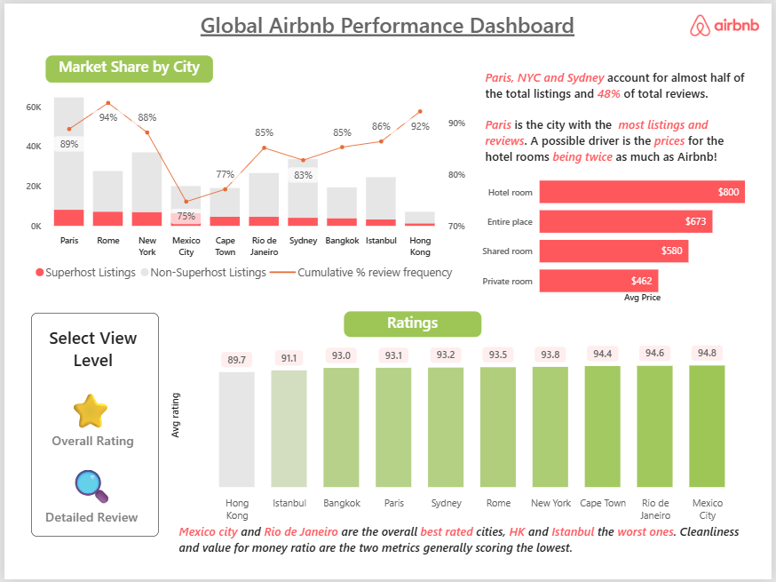
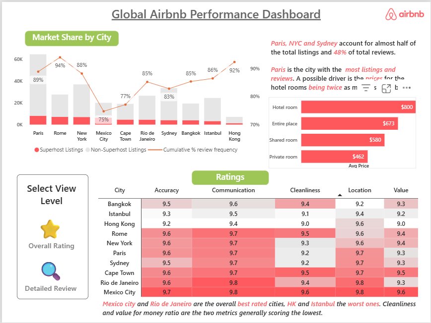
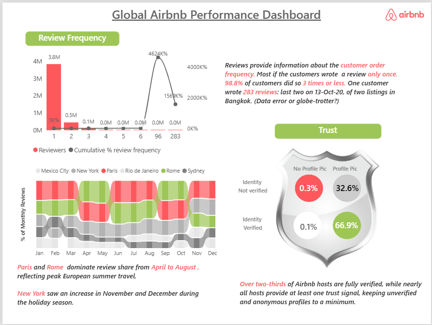

# 🏠 Global Airbnb Performance Dashboard

An interactive **Power BI** dashboard analysing Airbnb listings, hosts and guest reviews across **10 global cities**, built on the *Airbnb Listings & Reviews* dataset from [Maven Analytics](https://mavenanalytics.io/data-playground).

The dashboard tells the story of how Airbnb grew, which cities dominate the market, how much trust the platform builds with hosts, and how guests rate their stays.

---

## 📌 Table of Contents
- [Project Overview](#-project-overview)
- [Business Questions](#-business-questions)
- [Dataset](#-dataset)
- [Tools & Skills](#-tools--skills)
- [Dashboard Preview](#-dashboard-preview)
- [Key Insights](#-key-insights)
- [Recommendations](#-recommendations)
- [How to Use](#-how-to-use)
- [Author](#-author)

---

## 🎯 Project Overview

| Metric | Value |
|---|---|
| Listings | 279,712 |
| Cities | 10 |
| Hosts | 182,024 |
| Property Types | 144 |
| Reviews | 5.37M |

**Cities covered:** Paris, Rome, New York, Mexico City, Cape Town, Rio de Janeiro, Sydney, Bangkok, Istanbul, Hong Kong.

The report is split into three pages:

1. **Review Frequency & Trust** – reviewer behaviour, seasonality of reviews by city, and host verification.
2. **New Listings** – the growth story of Airbnb from 2008 onwards, split by room type.
3. **Market Share & Ratings** – city-level market share, superhost share, average prices and guest ratings (overall and detailed).

---

## ❓ Business Questions

- How often do guests leave reviews, and are there outliers?
- Which cities dominate review share, and how does this change through the year?
- How trustworthy is the host base (profile picture + identity verification)?
- How did new listings evolve over time, and what stages did Airbnb go through?
- Which cities hold the largest market share, and how much of it belongs to superhosts?
- How do prices differ by room type?
- Which cities are rated best and worst, and on which criteria do they score lowest?

---

## 📂 Dataset

- **Source:** [Maven Analytics – Airbnb Listings & Reviews](https://mavenanalytics.io/data-playground)
- **Content:** Listing details (city, property type, room type, price, ratings), host information (superhost status, profile picture, identity verification) and guest reviews (reviewer, date, listing).
- **Scope:** 10 cities, ~280K listings, ~182K hosts, ~5.4M reviews.


---

## 🛠 Tools & Skills

- **Power BI Desktop** – data modelling, DAX measures, interactive visuals
- **Power Query** – data cleaning and transformation
- **Dashboard design** – custom theme (Airbnb colours), bookmarks and buttons for view switching, annotated storytelling
- **Data storytelling** – written insight callouts next to every visual

---

## 🖼 Dashboard Preview


### 1. New Listings Over Time


### 2. Market Share & Ratings – Overall


### 3. Market Share & Ratings – Detailed Review


### 4. Review Frequency & Trust


---

## 🔍 Key Insights

### Review Frequency
- The vast majority of reviewers wrote only **one review** (~3.8M), followed by ~0.5M with two and ~0.1M with three.
- **98.8%** of reviewers wrote **3 reviews or fewer**.
- One extreme outlier wrote **283 reviews**, the last two on 13 Oct 2020 for two Bangkok listings – either a data error or a very dedicated globetrotter.

### Seasonality
- **Paris and Rome** dominate monthly review share from **April to August**, reflecting peak European summer travel.
- **New York** sees a rise in **November and December** during the holiday season.

### Trust
- **66.9%** of hosts are fully verified *and* have a profile picture.
- **32.6%** have a profile picture but are not identity-verified.
- Only **0.3%** have neither, so anonymous, unverified profiles are kept to a minimum.

### Growth of Airbnb (New Listings)
The new-listings curve is divided into six phases: **Introduction → Growth → Maturity → Decline → Reinvention → COVID-19**.
- New listings peaked in **2015**.
- A slowdown followed in **2016–2017**, linked to tightening local regulations.
- Growth resumed from **2018**, then stopped in **2019–2020** due to the **COVID-19 pandemic**.
- **Entire places** are the largest room-type segment, followed by private rooms; hotel rooms and shared rooms are marginal.

### Market Share by City
- **Paris** has the most listings and reviews, followed by Rome and New York.
- Superhosts make up only a small share of listings in every city.
- Average price by room type: **Hotel room $800**, **Entire place $673**, **Shared room $580**, **Private room $462**.

### Ratings
- **Best rated:** Mexico City (94.8) and Rio de Janeiro (94.6), followed by Cape Town (94.4).
- **Lowest rated:** Hong Kong (89.7) and Istanbul (91.1).
- Across cities, **Cleanliness** and **Value for money** score the lowest of the detailed criteria, while **Communication** and **Accuracy** score highest.

---

## 💡 Recommendations

1. **Focus on cleanliness and value** – the two weakest rating categories are the clearest levers to improve guest satisfaction, especially in Hong Kong and Istanbul.
2. **Plan for seasonality** – prepare supply and pricing for the summer peak in Paris and Rome and the holiday peak in New York.
3. **Encourage repeat reviewing** – nearly all guests review only once, so prompting follow-up stays and reviews could improve data richness and trust.
4. **Grow the superhost programme** – superhosts represent a small share of listings, leaving room to raise quality through incentives.
5. **Keep verification high** – the strong verified-host share is a trust asset worth maintaining.

---

## 🚀 How to Use

1. Clone this repository:
   ```bash
   git clone https://github.com/nabiieee/Airbnb-Performance-Dashboard
   ```
2. Open `Airbnb_Dashboard.pbix` in **Power BI Desktop**.
3. Use the **Select View Level** buttons on the ratings page to switch between *Overall Rating* and *Detailed Review*.

---

## 👤 Author

**Sucharita Samantaray**
- LinkedIn: [Sucharita Samantaray](linkedin.com/in/sucharitasamantaray/)
- GitHub: [Sucharita](https://github.com/nabiieee)
- Email: sucharita.madan13@gmail.com

---

⭐ If you found this project useful, feel free to star the repo!
